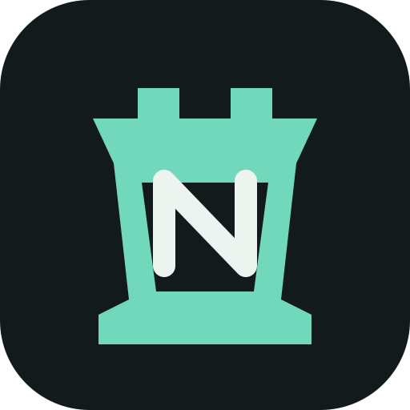

# NearChess



**Шахматы рядом. Интернет не нужен.**

NearChess — открытый Android-проект шахмат для игры на одном телефоне, тренировки и локальной партии с другом по Bluetooth.

> Текущий статус: **рабочий прототип, не готовый релиз**. Локальная доска, правила, простой бот, FEN/PGN, профиль, темы, часы и Bluetooth-протокол уже представлены в коде. Перед публикацией APK нужно закончить интеграцию и тестирование на двух реальных телефонах.

## Что уже есть в коде

### Шахматное ядро

- легальные ходы;
- шах, мат и пат;
- рокировка;
- взятие на проходе;
- превращение пешки в ферзя, ладью, слона или коня;
- ничья по недостатку материала, повторениям и 75 ходам;
- FEN: импорт и экспорт;
- PGN: экспорт;
- SAN для истории ходов;
- perft-тесты начальной позиции.

### Интерфейс

- Jetpack Compose + Material 3;
- оригинальный логотип **ладья + N**: `assets/nearchess-logo.svg`;
- мятно-графитовая тема и dynamic dark color на Android 12+;
- пять тем доски;
- Canvas-доска с кликами и drag-and-drop;
- подсветка выбранной клетки, доступных ходов, последнего хода и шаха;
- профиль с ником и локальным аватаром;
- сохранение локальной партии;
- режимы на одном устройстве: без часов и с 3+2, 5+0, 10+5.

### Bluetooth и чат

- RFCOMM-транспорт;
- версия протокола, sequence number и ограничение размера кадра;
- host/guest роли;
- проверка легальности хода на стороне host;
- синхронизация FEN-состояния;
- сообщения и emoji-реакции;
- сдача и завершение партии;
- строгий UCI-разбор ходов;
- тесты протокола и игровой сессии.

## Что ещё нужно закончить

Это не скрыто: следующие пункты пока **не считаются реализованными полностью**:

- подключить часы к Bluetooth-протоколу и синхронизировать их между телефонами;
- сохранять сетевую партию и восстанавливать её после перезапуска;
- автоматическое переподключение после обрыва;
- передавать аватар и профиль друга либо согласованный идентификатор профиля;
- общий Material 3-аудит всех экранов, а не только главного;
- TalkBack-семантика для Canvas-доски;
- плавные анимации перемещения и рокировки;
- полноценный импорт PGN;
- архив нескольких партий;
- более сильный движок Stockfish и задачи тренировки;
- иконка APK, adaptive icon и release signing;
- расширенные device-тесты Bluetooth.

## Структура

```text
app/src/main/java/dev/nearchess/
├── Chess.kt              # правила, FEN, SAN и ходы
├── ChessClock.kt          # Fischer-часы
├── BoardView.kt           # Canvas-доска, клики и drag-and-drop
├── MainActivity.kt        # локальная партия и простой бот
├── TimedActivity.kt       # локальные партии с часами
├── NearbyActivity.kt      # Bluetooth-лобби, ходы и чат
├── BluetoothTransport.kt  # RFCOMM
├── Wire.kt                # протокол кадров
├── Uci.kt                # разбор UCI
├── ProfileActivity.kt     # ник и локальный аватар
├── NearTheme.kt           # Material 3-тема и логотип
└── LaunchActivity.kt      # главный экран
```

## Сборка

Требования: JDK 17, Android SDK 35, Gradle 8.9.

```bash
gradle testDebugUnitTest assembleDebug
```

GitHub Actions запускает тесты и debug APK после push в `main`:

- [Последние сборки](https://github.com/W0rd3r566/NearChess/actions)
- APK появляется в артефакте `NearChess-debug` только после зелёной сборки.

## Запуск Bluetooth-партии

1. Установите debug APK на два Android-телефона.
2. На обоих включите Bluetooth и выполните системное сопряжение.
3. На первом откройте **С другом по Bluetooth → Создать партию**.
4. На втором выберите сопряжённый телефон и подключитесь за чёрных.
5. После соединения host проверяет очередь и легальность ходов.

Пока Bluetooth-режим не имеет полноценного восстановления после обрыва и сетевых часов — это известные ограничения прототипа.

## Лицензии и материалы

- Код NearChess планируется распространять под GPL-3.0-or-later; полный `LICENSE` нужно добавить до публичного релиза.
- Логотип `assets/nearchess-logo.svg` — оригинальная работа проекта.
- Сторонние фигуры Chess.com и их ассеты не используются.
- Material 3 используется как дизайн-система; ссылки и заметки находятся в [`docs/material3.md`](docs/material3.md).
- При добавлении Stockfish нужно сохранить требования GPLv3 и уведомления зависимостей.

## Проверки перед релизом

- [ ] CI зелёный на последнем коммите.
- [ ] Все unit-тесты правил и протокола проходят.
- [ ] Проверены два физических телефона с Android 12+.
- [ ] Проверены отказ разрешений и выключенный Bluetooth.
- [ ] Проверено переподключение или явно добавлена политика восстановления.
- [ ] Проверены TalkBack, маленький экран и планшет.
- [ ] Добавлены `LICENSE` и notices зависимостей.
- [ ] Собран подписанный release APK.
